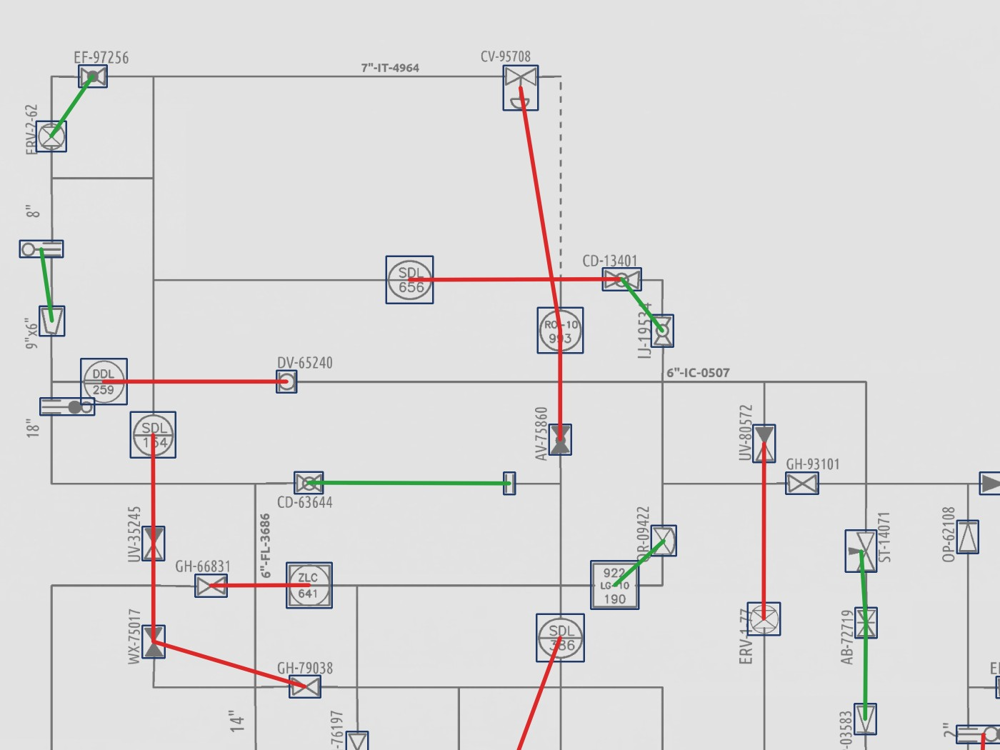
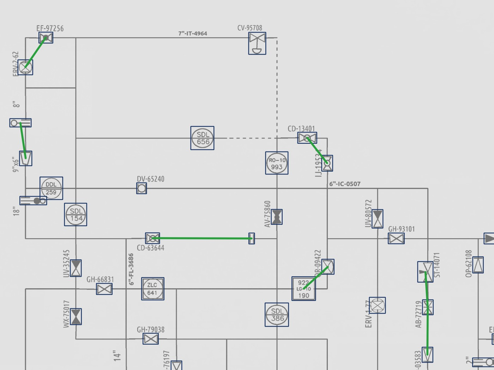
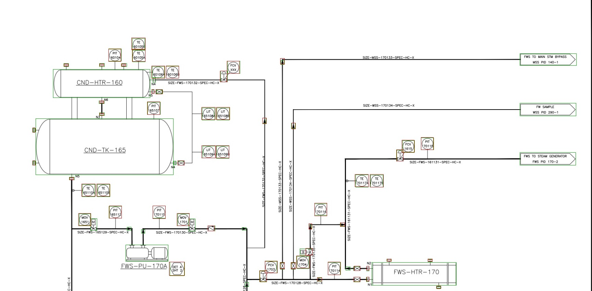
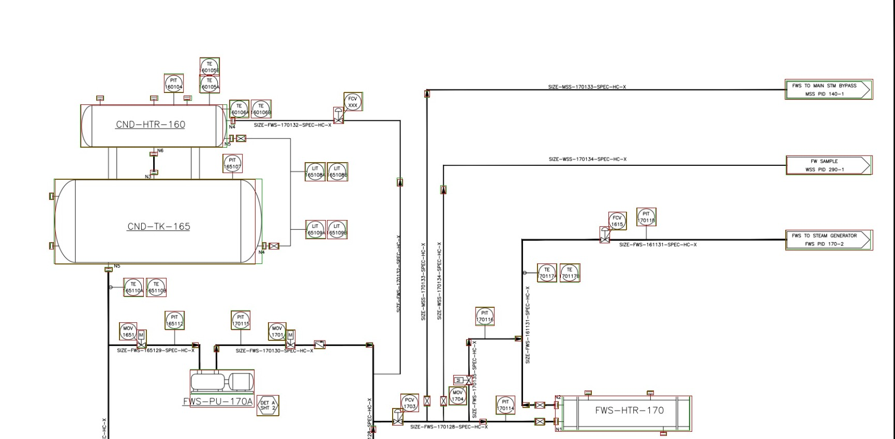

# CNN 기반 P&ID 분석

P&ID(배관계장도) 도면에서 설비 기호를 찾고, 기호 사이의 배관 연결을 그래프로 뽑아내는 캡스톤 프로젝트입니다.

## 문제 정의

- **대상 분야**: 발전소, 그중 원전 계통 도면. 정답이 붙은 공개 실제 도면(OPEN100)이 있는 분야라서 골랐습니다.
- **풀 문제**: 분야를 가리지 않는 합성 도면으로 학습한 모델을, 대상 분야의 실제 도면 몇 장으로 맞추는 방법.

## 처리 순서

| 단계 | 도구 | 내용 |
|---|---|---|
| 1. 기호 찾기 | YOLOv8s | 도면을 1024 조각으로 잘라 학습·예측 |
| 2. 선 찾기 | OpenCV | 가로·세로 선과 점선을 이미지에서 추출 (학습 없음) |
| 3. 잇기 | Shapely | 선이 기호 박스에 닿는지, 선끼리 만나는지 계산 |
| 4. 그래프 | NetworkX | 기호와 분기점은 노드, 배관은 간선 |

## 결과 요약 (2026-10-05 기준)

### 합성 도면: 기호 탐지와 연결 그래프

시험 도면 100장 기준입니다. 연결은 두 가지로 채점했습니다. PID2Graph 정답 그래프의 연결된 기호 쌍과 직접 비교한 F1, 그리고 PIDQA 질문 정답률입니다.

| 조건 (YOLO 기호, 완전 자동) | 연결 쌍 F1 | 질문: 개수 | 질문: 연결 여부 |
|---|---|---|---|
| 처음 규칙 (v1) | 0.587 | 87.7% | 92.4% |
| 고친 규칙 (v2) | 0.983 | 97.8% | 98.3% |
| 상한: 정답 그래프로 질문을 풀 때 | — | 98.6% | 99.9% |

- 기호 탐지: 도면 단위 정밀도 1.000, 재현율 0.996. 기호 종류 정확도 99.98%.
- 규칙은 50장으로 조정하고 나머지 50장으로 검증했습니다. 정답 기호 기준 F1은 조정용 0.988, 검증용 0.986입니다.
- v1의 문제는 잘못 이은 쌍이었습니다(정밀도 0.43). 선이 십자로 만나는 곳을 그냥 지나쳤습니다.

| 처음 규칙 | 고친 규칙 |
|---|---|
|  |  |

초록은 맞게 이은 쌍, 빨강은 잘못 이은 쌍입니다.

### 실제 도면: 합성으로만 학습한 모델을 그대로 넣으면

실제 원전 설계 도면 12장(기호 1,439개), 기호 종류는 무시하고 위치만 채점했습니다.

| 모델 | 정밀도 | 재현율 | F1 |
|---|---|---|---|
| 기존 모델 | 0.871 | 0.581 | 0.697 |
| 깨끗한 데이터로 20회 더 학습 | 0.823 | 0.563 | 0.669 |
| 스캔처럼 망가뜨린 데이터로 20회 학습 | 0.856 | 0.690 | 0.764 |
| (참고) 합성 시험 도면 | 1.000 | 0.996 | 0.998 |

### 실제 도면 6장을 학습에 넣으면

12장을 6장 학습 / 6장 시험(기호 634개)으로 나눴습니다.

| 모델 | 정밀도 | 재현율 | F1 | 종류까지 F1 |
|---|---|---|---|---|
| 기존 모델 (합성 데이터만) | 0.807 | 0.718 | 0.760 | 0.715 |
| + 다른 합성 데이터 보강 | 0.748 | 0.776 | 0.762 | 0.735 |
| + 실제 도면 6장 추가 학습 | 0.957 | 0.943 | 0.950 | 0.923 |
| 기존 모델 + 실제 도면 6장만 | 0.951 | 0.954 | 0.953 | 0.923 |

| 합성 데이터만 학습 | 실제 도면 6장 추가 학습 |
|---|---|
|  |  |

초록은 정답, 빨강은 예측입니다.

이 표의 기존 모델 수치가 위 표와 다른 이유는 조건이 달라서입니다. 위 표는 12장을 한 가지 배율로, 이 표는 시험용 6장을 두 가지 배율(확대 조각 + 전체 축소)로 본 결과입니다.

### 실제 도면의 연결

정답 기호를 주고 연결만 채점했습니다 (실제 도면 12장).

| 규칙 | 정밀도 | 재현율 | F1 |
|---|---|---|---|
| v1 | 0.650 | 0.272 | 0.383 |
| v2 | 0.732 | 0.300 | 0.426 |
| v2 + 맞닿은 기호끼리 연결 | 0.757 | 0.423 | 0.542 |

합성 도면에서 통한 규칙이 실제 도면에서는 거의 통하지 않습니다. 실제 도면은 계기를 선 없이 붙여 그리고 신호선을 사선으로 그립니다.

## 한계

- 실제 도면은 한 출처의 12장뿐입니다. 다른 출처 도면에서도 통하는지는 확인하지 못했습니다.
- 실제 도면 학습 실험은 한 번만 나눠 봤고, 가장 좋은 학습 시점을 고를 때 시험 도면을 기준으로 썼습니다. 수치는 낙관적입니다.
- 펌프 16개가 모두 시험용 6장에만 있어서, 펌프는 종류를 하나도 맞히지 못했습니다.
- 선 검출은 가로·세로 선만 찾습니다.
- 연결 정답(PIDQA, PID2Graph)은 둘 다 자동 생성입니다. 서로 98.6% / 99.9% 일치하지만 사람이 검수한 것은 아닙니다.

## 저장소 구성

| 경로 | 내용 |
|---|---|
| `pid_tools_v2/` | 선 검출, 그래프 생성, 채점, 학습·평가 스크립트 (실행법은 폴더 안 README) |
| `data_prep/` | 도면을 조각으로 자르는 스크립트, 기호 통계 |
| `results/` | 실험 결과 숫자 파일 (json, csv) |
| `docs/figures/` | 결과 그림 |
| `scripts/check_environment.py` | 환경 점검 |

`results/` 안의 실행별 폴더는 다음과 같습니다.

| 폴더 | 내용 |
|---|---|
| `run_1001/` | 서버 1~3단계: v1 연결 그래프, 실제 도면 격차, 추가 학습 2종 |
| `run_1005_local/` | 연결 규칙 v2: 단계별 효과(`ablation.json`), 실제 도면 연결(`real_graph.json`) |
| `run_1005_real_ft/` | 실제 도면 학습 실험(`real_finetune.json`) |

데이터, 모델 가중치, 큰 그림 파일은 저장소에 올리지 않습니다.

## 실행 준비

```powershell
.\.venv\Scripts\Activate.ps1
python -m pip install -r requirements.txt
python scripts\check_environment.py
python pid_tools_v2\tests\test_toy.py      # 가짜 도면으로 자체 시험
```

학습과 평가는 GPU 서버에서 `pid_tools_v2/stage1_analysis.sh` ~ `stage4_real.sh` 순서로 실행합니다.

## 데이터 출처

| 데이터 | 용도 | 출처 |
|---|---|---|
| Dataset-P&ID | 합성 도면 500장, 기호 32종 | Paliwal et al., Digitize-PID (2021). YOLO 변환본: HuggingFace `hamzas/digitize-pid-yolo` |
| PIDQA | 같은 도면에 대한 질문 64,000개와 정답 | Gupta et al. (2025), github.com/mgupta70/PIDQA |
| PID2Graph | 정답 그래프, 실제 도면(OPEN100) 12장, 다른 합성 도면 250장 | Stürmer et al. (2025), zenodo.org/records/14803338, CC BY-SA 4.0 |

`docs/figures/`의 실제 도면 그림은 PID2Graph의 OPEN100 도면(Energy Impact Center, open-100.com)에 정답과 예측 박스를 겹쳐 그린 것입니다.
